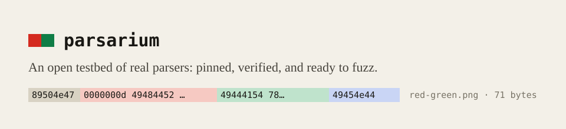

<p align="center"><a href="https://parsarium.com"></a></p>

<p align="center">
  <a href="https://parsarium.com">Website</a> ·
  <a href="https://parsarium.com/bench/">Bench</a> ·
  <a href="https://parsarium.com/atlas/">Atlas</a> ·
  <a href="https://parsarium.com/manual/">Manual</a> ·
  <a href="https://pypi.org/project/parsarium/">PyPI</a>
</p>

<p align="center">
  <a href="https://pypi.org/project/parsarium/"></a>
  
  <a href="LICENSE"></a>
</p>

# Parsarium

Parsarium is an open testbed of real parsers for software testing and security research. It collects open-source libraries and standard-library APIs that read ten formats in eight languages, and wraps them in pinned, instrumented Docker harnesses. You can run one file through a parser, send the same file to every parser of a format, replay a generated corpus, or start an AFL++ campaign, and every step leaves a JSON receipt.

Every target has:

- a **pinned release**, installed from a lock file with its source hash recorded;
- the **documented input API** that parses the bytes, not generic file handling;
- a small **valid control** file and the output the parser must report for it;
- a **Docker harness** with a verification receipt: image ID, toolchain, file hashes, and parser coverage;
- an **AFL++ overlay** with its own feedback receipt, plus the language's native fuzzing engine.

| Formats | Languages |
| --- | --- |
| PNG · ZIP · MP4 · WAV · PDF · SVG · HTTP/1.1 · ASCII PLY · ASCII PNM · MP3 + ID3v2 | C · C++ · Go · Java · JavaScript · Python · Rust · PHP |

Current counts per format and language are on the [atlas](https://parsarium.com/atlas/) and in `parsarium list`.

## Install

```sh
pip install parsarium
```

Requires Python 3.11+, and Docker (Linux amd64 or arm64 images) to run targets. The package has no dependencies. On first use it downloads the snapshot of harnesses, controls, and catalog data for its version, checks its SHA-256, and keeps it in your cache directory. Each package version pins one snapshot, so a version identifies an exact set of targets.

Working from a clone instead? Run `python3 parsarium.py …` from the repository root, or set `PARSARIUM_HOME` to the clone and use the `parsarium` command anywhere.

## Quick tour

```sh
parsarium list --format png        # verified and runnable parsers per language
parsarium catalog png rust         # one cell's ranking, metric, and open leads
parsarium show png c stb           # release, input API, control, fuzz engine

parsarium run png c stb my.png --results runs/stb                       # one file, one parser
parsarium run-format png --file my.png --results runs/png --workers 4   # one file, every PNG parser
parsarium replay png c stb corpus/ runs/stb-replay                      # a whole corpus

parsarium afl build png c stb                                           # AFL++
parsarium afl prepare png c stb runs/stb-afl --seed-dir corpus/
parsarium afl run runs/stb-afl --seconds 3600
parsarium afl summary runs/stb-afl
```

`status: ok` in a run receipt means the harness finished; whether the parser accepted the input is in its output. Formats are `png`, `zip`, `mp4`, `wav`, `pdf`, `svg`, `http11`, `ascii_ply`, `ascii_pnm`, `mp3_id3v2`; languages are `c`, `cpp`, `go`, `java`, `javascript`, `python`, `rust`, `php`.

To work with a subset, build a selection on the [bench](https://parsarium.com/bench/). It gives the selection a stable ID, a manifest, and a report table, and the package runs the manifest directly:

```sh
parsarium run-selection sel-90378f4e58.json --mode afl --seconds 600
```

### From Python

```python
from parsarium import catalog

for target in catalog.targets(format="zip", ecosystem="go"):
    print(target.id, target.release, target.family, target.input_api)
```

## What you can use it for

- **Comparing fuzzers and test generators** on the same pinned targets, with one target per parser family when engines matter more than wrappers.
- **Differential testing**: send one input to every implementation of a format and look at where they disagree.
- **Corpus evaluation**: replay inputs from [Fandango](https://fandango-fuzzer.github.io/) or any other generator through many parsers, then use them as AFL++ seeds.
- **Teaching**: the [manual](https://parsarium.com/manual/) covers formats, controls, coverage feedback, differential testing, fuzzing at scale, triage, and experiment design, with quizzes and exercises that run on Parsarium.

## How targets are chosen

The catalog is built one format × language cell at a time. Registry searches find candidates; a candidate becomes an entry only after it parses a valid control through its documented API and reports the expected, format-specific result. Packages are ranked by one adoption metric per cell and only against other packages in that cell. Wrappers are allowed, and the parser family behind each one is recorded. Standard-library APIs are verified the same way and listed separately. Every query, hit count, and open lead is saved next to the cell.

The full rules are in the [selection protocol](PROTOCOL.md). The [harness guide](projects/README.md) describes what a target contains, and the [fuzzing guide](fuzzing/README.md) covers AFL++, bridges, native engines, and run files.

## Repository layout

| Path | Contents |
| --- | --- |
| `catalog/<format>/` | Generated guides for every format, cell, and parser |
| `data/<language>/<format>/` | Verified parsers, rankings, search leads, standard APIs, and evidence |
| `controls/<format>/` | The valid control files and the scripts that make them |
| `projects/<format>/<language>/<slug>/` | Dockerfile, harness, manifest, and verification receipt for each target |
| `fuzzing/` | AFL++ overlays, coverage bridges, and their feedback receipts |
| `adapters/` | Catalog verification adapters and source locks |
| `scripts/` | Verification, audit, discovery, and build tools |
| `src/parsarium/` | The PyPI package |
| `website/` | The [parsarium.com](https://parsarium.com) source, built from the catalog |

## Maintaining the catalog

```sh
python3 scripts/validate_catalog.py         # catalog data consistency
python3 scripts/audit_projects.py --check   # manifests and receipts against the catalog
python3 scripts/audit_fuzzing.py            # harness and AFL++ receipts
python3 scripts/build_readmes.py            # regenerate catalog and project guides
python3 website/build.py                    # build the website into website/dist
```

Pushes to `main` that touch the catalog or the website redeploy [parsarium.com](https://parsarium.com). A version tag publishes the package: set `__version__` in `src/parsarium/__init__.py` (calendar versions, such as `2026.11.16`), commit, then `git tag v2026.11.16 && git push origin v2026.11.16`. The [release workflow](.github/workflows/release.yml) builds a byte-reproducible snapshot with `scripts/build_snapshot.py`, attaches it to a GitHub release, smoke-tests the wheel, and uploads it to PyPI with trusted publishing.

## Citing

Cite the package version (`parsarium --version`) or the commit you used, and the selection ID if you worked with a subset.

```bibtex
@misc{parsarium,
  author       = {Zamudio Amaya, Jos{\'e} Antonio},
  title        = {Parsarium: An Open Testbed of Real Parsers},
  year         = {2026},
  howpublished = {\url{https://parsarium.com}}
}
```

## License

Parsarium is licensed under the [Apache License 2.0](LICENSE). Each parser keeps its own license, recorded in the catalog.
