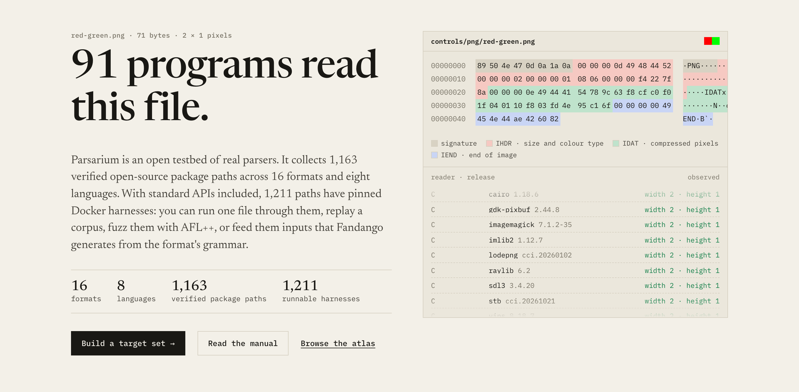

# Parsarium

<p align="center">
  <a href="https://github.com/joszamama/parsarium/actions/workflows/verify.yml"></a>
  <a href="https://github.com/joszamama/parsarium/actions/workflows/pages.yml"></a>
  <a href="https://pypi.org/project/parsarium/"></a>
  <a href="https://pypi.org/project/parsarium/"></a>
  <a href="LICENSE"></a>
  <a href="https://parsarium.com/"></a>
</p>

**An open testbed of real parsers.** Pinned, verified Docker harnesses for 1,163 open-source parser paths across 16 file formats and protocols in eight languages, ready to run, compare, and fuzz with AFL++ and Fandango.

<p align="center">
  <a href="https://parsarium.com/">
    <picture>
      <source media="(prefers-color-scheme: dark)" srcset=".github/assets/readme-hero-dark.png">
      
    </picture>
  </a>
</p>

<p align="center">
  <a href="https://parsarium.com/">Website</a> ·
  <a href="https://parsarium.com/bench/">Bench</a> ·
  <a href="https://parsarium.com/atlas/">Atlas</a> ·
  <a href="https://parsarium.com/manual/">Manual</a> ·
  <a href="PROTOCOL.md">Selection protocol</a> ·
  <a href="ETHICS.md">Ethics</a>
</p>

## What is in it

Parsarium catalogs open-source parsers by **format** and **language**. For each pair, a *cell*, it selects up to ten third-party packages that read that format, ranked by how widely they are used in that language. Every selected package comes with a pinned release, a documented input API, and a Docker harness that is checked against valid control files and measures coverage in the parser's own source. Every target can then be:

- run on your own files or on a whole corpus, with a JSON receipt per input;
- fuzzed with AFL++ (each target has its own overlay), and most also with their language's native fuzzer (libFuzzer, Go fuzzing, Jazzer, Jazzer.js, Atheris, PHP-Fuzzer);
- fed inputs that [Fandango](https://fandango-fuzzer.github.io/) generates from the format's grammar (every format has one).

| | |
| --- | --- |
| Formats (16) | PNG, ZIP, MP4, WAV, PDF, SVG, HTTP/1.1 requests, ASCII PLY, ASCII PNM, MP3, JSON, XML, YAML, TOML, SQL, DNS messages |
| Languages (8) | C, C++, Go, Java, JavaScript, Python, Rust, PHP |
| Parser paths | 1,163 third-party packages in 128 cells, plus 48 standard-library APIs with harnesses |
| Full cells | 105 of 128 have ten paths |

The other 23 cells have fewer than ten because not enough packages qualify, for example YAML and TOML in C or DNS in C++. Each of those cells records what was searched and why it stopped, rather than filling up with packages that fail a check. Rankings compare packages only **within one cell**: download counts from npm and installation counts from Debian are not comparable, and several packages may wrap the same underlying parser, which the catalog states.

The first ten formats were curated together and share one [selection plan](data/curation/plan.json); JSON, XML, YAML, TOML, SQL and DNS were added later and keep their records per cell (they are labeled `pilot` in the data). The [selection protocol](PROTOCOL.md) and the [curation record](data/curation/README.md) explain the adoption metrics, secondary sources, exclusions, and remaining uncertainty.

The [website](https://parsarium.com/) is built from this repository on every push: it helps you choose a format, find a documented parser, and assemble a runnable target set.

## Install

```sh
python3 -m pip install parsarium
parsarium list --format png
```

The package provides the `parsarium` command and a small Python API
(`from parsarium import catalog`). Each wheel bundles a versioned snapshot of
harnesses, controls, and catalog data. On first use it checks the snapshot's
SHA-256 and extracts it to your cache directory without a network request, so
each package version pins one snapshot. `parsarium run-selection MANIFEST` runs
a selection saved from the [bench](https://parsarium.com/bench/).

To work from a clone instead, install it in editable mode and point
`PARSARIUM_HOME` at it:

```sh
git clone https://github.com/joszamama/parsarium.git
cd parsarium
python3 -m pip install -e .
export PARSARIUM_HOME="$PWD"
```

## Start here

Requirements: Python 3.11+, and Docker for anything that runs a parser. Browsing the catalog needs only Python. The examples use `python3 parsarium.py` from a clone; with the installed package, `parsarium` takes the same commands.

```sh
python3 parsarium.py list --format png
python3 parsarium.py catalog png python
python3 parsarium.py projects --format png
python3 parsarium.py show png python pypng
python3 parsarium.py run png python pypng controls/png/red-green.png
```

`list` shows verified and runnable counts for each format and ecosystem. `catalog` shows the ranking, metric, search limits, and unresolved leads. `projects` lists container harnesses. `show` displays a harness's pinned release, parser API, control, and fuzz engine. `run` returns a JSON receipt for one supplied file; `status: ok` means the harness completed, not necessarily that the parser accepted the input. `--json` is available for `list`, `catalog`, `projects`, and `show`.

Run every fully verified Docker target for one format with its own pinned control, or send the same file to each target. Results are saved under one directory, with a receipt per target and a `summary.json`:

```sh
python3 parsarium.py run-format png --list
python3 parsarium.py run-format png --results runs/png-controls
python3 parsarium.py run-format png --file my.png --results runs/png-my-file
```

Use `--ecosystem python` to narrow the batch. A shared file may be accepted by some parsers and rejected by others; the receipts record each outcome.

`run` and `run-format` report whether a harness completed. To see what each parser read, `observe` runs every target's verification check (the one that checks the valid control) once per corpus file, with that file in place of the control, and keeps the value the check computed. Each target gets a JSON Lines file with one record per input: `accepted` with the `observed` value and whether it equals the control's expected output, `rejected` with the parser's error, `harness_error` when the check failed for a reason unrelated to the parser, or `timeout`. A coverage step that fails after the value was read does not change an `accepted` record. Interrupted runs resume where they stopped.

```sh
python3 parsarium.py observe png --corpus runs/lodepng-fandango/generated --results runs/png-observe --workers 6
```

Some harnesses report only the fields of their control, or accept only inputs shaped like it (for example a 2×1 image); `summary.json` lists targets that rejected every input except the control and targets that reported the same value for every input.

Formats: `png`, `zip`, `mp4`, `wav`, `pdf`, `svg`, `http11`, `ascii_ply`, `ascii_pnm`, `mp3`, `json`, `xml`, `yaml`, `toml`, `sql`, `dns`. Ecosystems: `c`, `cpp`, `go`, `java`, `javascript`, `python`, `rust`, `php`.

## Fuzzing

Every runnable project has an AFL++ overlay with parser-dependent feedback. AFL++ instruments compiled C, C++, and Rust targets directly. Go, Java, JavaScript, Python, and PHP harnesses use parser coverage bridges. A prepared run includes a valid seed, pinned image ID, exact command, and output directory.

```sh
python3 parsarium.py afl build png python pypng
python3 parsarium.py afl prepare png python pypng runs/pypng-afl
python3 parsarium.py afl run runs/pypng-afl --check
python3 parsarium.py afl run runs/pypng-afl --seconds 60
python3 parsarium.py afl summary runs/pypng-afl
```

Additional seeds enter with `--seed FILE` or `--seed-dir DIRECTORY` on `afl prepare`. `afl run --resume` continues an existing output directory. AFL++ saves interesting inputs in `queue/`, potential crashes in `crashes/`, potential timeouts in `hangs/`, and progress in `fuzzer_stats`.

After a run has saved queue files, `report --replay-queue` measures parser source lines reached by a bounded sample. It replays each selected input once in the project's verified coverage image; it does not start AFL++. LLVM-covered C, C++ and Rust merge profiles from `/work/replay`; Go replays one fuzz test corpus seed per input; Java replays literal verified harness commands and unions JaCoCo source lines, including pinned JDK module-patch paths. Python, PHP and JavaScript package paths use Python `trace`, PHP Xdebug or Node V8 coverage. The report records input hashes, both image IDs, and hashes of profiles or trace exports. The LWJGL/Assimp Java/native hybrid and the standard Node `JSON.parse` path are labeled unsupported for queue line replay; each has separate valid-control coverage and AFL feedback.

```sh
python3 parsarium.py report http11 cpp boost_beast runs/beast-afl \
  --output reports/beast-afl --replay-queue --max-queue-inputs 32
```

Each project also has a plan for its ecosystem fuzz engine:

```sh
python3 parsarium.py build png python pypng
python3 parsarium.py native prepare png python pypng runs/pypng-native --duration-seconds 60
python3 parsarium.py native run runs/pypng-native --check
python3 parsarium.py native run runs/pypng-native
```

[Fandango and Fanbase](https://fandango-fuzzer.github.io/Fanbase.html) generate inputs from format specifications. `fandango setup` installs Fandango 1.3.1 and its dependencies from a [hash-locked requirements file](fuzzing/fandango/requirements.lock) in the ignored local `.venv/`. `fandango generate` runs it for one verified project, writes a receipt, and can replay the corpus or prepare (not start) an AFL++ run. On Linux arm64, install a C compiler before setup: the locked `accumulation-tree` release builds from source there.

```sh
python3 parsarium.py afl build png c lodepng
python3 parsarium.py fandango setup
python3 parsarium.py fandango generate png c lodepng runs/lodepng-fandango \
  --count 100 --seed 42 --replay --prepare-afl
python3 parsarium.py afl run runs/lodepng-fandango/afl --check
```

Fanbase supplies the default specs for `png`, `zip`, `wav`, `json`, `xml`, and MP3 targets verified on the ID3v2-tagged control (`mp3` in Fanbase, including an ID3v2.3 tag). Parsarium supplies local specs for MP4, PDF, SVG, HTTP/1.1 requests, ASCII PLY, ASCII PNM P3, YAML, TOML, SQL, DNS messages, and MP3 targets verified on untagged Layer III frames. Most Fanbase `svg` outputs have zero or near-zero sizes, references to undefined ids or invalid property values, so SVG defaults to a local grammar of renderable SVG 1.1 documents; `--fanbase svg` still selects Fanbase's. `--fanbase` selects a Fanbase variant such as `png-boundary`; `--spec` selects another local spec. Every format has a default generation route. The MP4 grammar includes one decodable 2×2 H.264 video frame and no audio track. Parsers may differ in which valid grammar variations they accept; replay records each outcome.

MP3 targets verified on untagged frames use a [local Layer III seed grammar](fuzzing/fandango/plain-mp3-decision.md). Fanbase's `-F mp3` grammar emits tags and Layer I/II frames, so it cannot be converted to those targets by stripping tags.

```sh
python3 parsarium.py fandango generate mp4 cpp exiv2 runs/exiv2-fandango \
  --count 100 --seed 42 --replay
```

The run directory must be new or empty, and inside this repository it must be under `runs/` or `generated/`, which Git ignores. It contains `generated/`, a copy or snapshot of the spec, and `fandango.json`. The receipt records the Fandango executable path, SHA-256, version, requirements-lock hash, and installed dependencies; the exact command and environment; the seed (`--random-seed`, also used as `PYTHONHASHSEED`); the spec hash; and each output's SHA-256 and size. `--fanbase-registry DIR` pins a local Fanbase checkout and checks the installed spec against its `index.yml`. Without it, the registry revision is not recorded; only the installed spec snapshot is. If Fandango fails, writes no files, or writes empty, oversized, or linked files, the command stops before replay or AFL++ preparation.

The [fuzzing guide](fuzzing/README.md) describes feedback, run artifacts, and result interpretation. Corpus replay reports show per-input outcomes. The optional AFL++ queue replay above measures aggregate source lines from saved queue inputs; without it, line views come from the pinned valid-control build.

## Evidence and layout

| Path | Contents |
| --- | --- |
| `data/<ecosystem>/<format>/` | Verified parsers, ranking, search leads, standard APIs, control results, and release evidence |
| `data/curation/` | Ten-path selection, pinned adoption sources, metric exceptions, and original verification evidence |
| `controls/<format>/` | Small valid inputs used for parser verification |
| `projects/<format>/<ecosystem>/<slug>/` | Dockerfile, byte-input harness, manifest, and coverage receipt |
| `fuzzing/afl-native/<format>/<ecosystem>/<slug>/` | AFL++ overlay and feedback receipt |
| `adapters/` | Catalog verification adapters and source locks |
| `scripts/` | Rebuild, audit, and discovery utilities |

The [selection protocol](PROTOCOL.md) defines parser eligibility, ranking, stopping rules, and uncertainty. The [project guide](projects/README.md) describes the harness contract. `python3 scripts/validate_catalog.py` checks catalog data; `python3 scripts/audit_fuzzing.py` checks the committed harness and AFL++ receipts.

The valid controls cover specific format subsets. A successful control does not establish support for every variant, security, or resource limits. Package paths that share an underlying parser are identified in the catalog. AFL++ feedback counts from different instrumentation methods are not comparable.

## License

Parsarium is licensed under the [Apache License 2.0](LICENSE). Each parser keeps its own license, recorded in the catalog.

## Project documents

- [PROTOCOL.md](PROTOCOL.md): parser eligibility, ranking, adoption metrics, stopping rules.
- [ETHICS.md](ETHICS.md): what Parsarium is for, how to handle findings, and what it does not do.
- [CONTRIBUTING.md](CONTRIBUTING.md): suggesting parsers, reporting wrong records, and the checks a pull request must pass.
- [SECURITY.md](SECURITY.md): reporting a vulnerability in Parsarium itself.
- [AGENTS.md](AGENTS.md): repository map and working rules for automated contributors.
- [CITATION.cff](CITATION.cff): how to cite Parsarium.

Releases are published to PyPI from version tags by `.github/workflows/release.yml`, which builds a byte-reproducible snapshot with `scripts/build_snapshot.py` and smoke-tests the wheel before upload.
